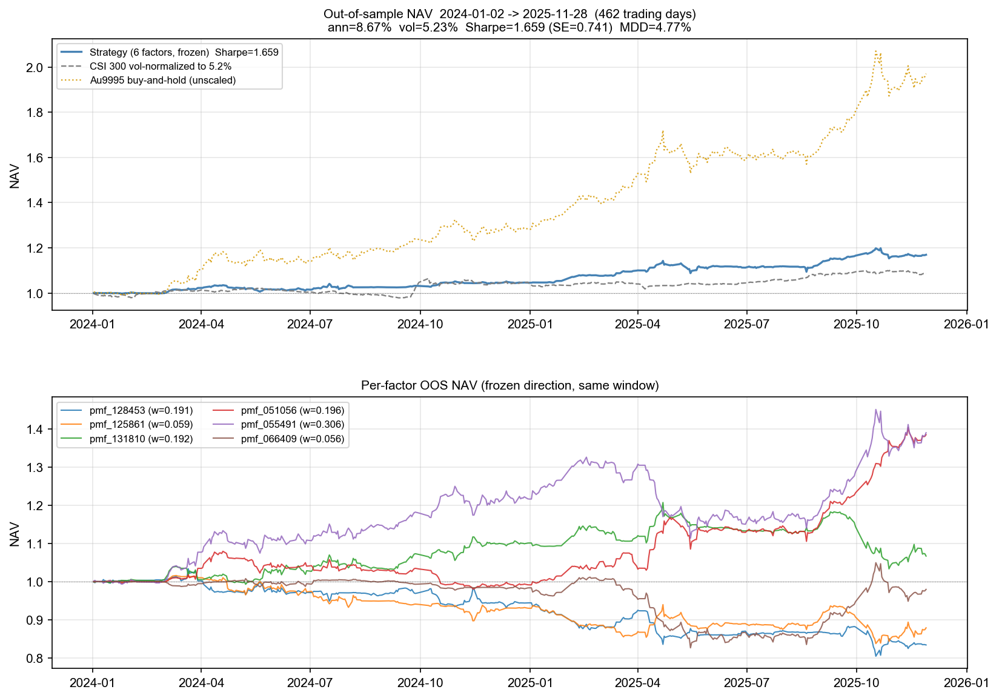
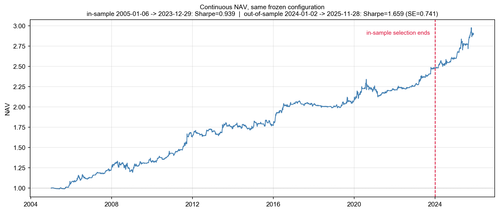

# Out-of-Sample Test — 6 frozen factors, 2024-01-02 → 2025-11-28

A strict out-of-sample re-run of the configuration selected in [`../README.md`](../README.md),
on 462 trading days of data the selection never saw. Every fitted quantity —
factor formulas, trade directions, portfolio weights, mapping style and
execution parameters — is frozen at its in-sample value. Nothing is re-tuned.

**Headline: the strategy survived out-of-sample, but it did not add alpha.**
The OOS Sharpe of 1.66 is higher than in-sample, and essentially all of it is
passive exposure to a gold market that rose 97% over the window. Details in
[Return attribution](#return-attribution) — that section is the point of this
folder, not the headline number.

---

## Results

| | **Strategy (frozen)** | Au9995 buy-and-hold | Au9995 @ 5.23% vol | CSI 300 @ 5.23% vol |
|---|---:|---:|---:|---:|
| **Sharpe** | **1.659** ± 0.741 | 2.321 | **2.321** | 0.896 |
| Annualized return | 8.67 % | 38.38 % | 12.13 % | 4.68 % |
| Annualized vol | 5.23 % | 16.53 % | 5.23 % | 5.23 % |
| Max drawdown | **-4.77 %** | -11.08 % | -3.59 % | -4.37 % |
| Calmar | 1.818 | 3.464 | 3.379 | 1.071 |
| Win rate (daily) | 54.97 % | 58.71 % | 58.71 % | 52.16 % |
| Cumulative return | 16.93 % | 97.01 % | 24.59 % | 8.69 % |

`±` is the Lo (2002) standard error of the annualized Sharpe. 462 days is a
short window; the 95% CI on the strategy's OOS Sharpe is **[0.21, 3.11]**.

### In-sample vs out-of-sample

| Window | Days | Ann. return | Ann. vol | Sharpe | MDD | Calmar |
|---|---:|---:|---:|---:|---:|---:|
| In-sample, full (2005-01-06 → 2023-12-29) | 4,614 | 5.12 % | 5.45 % | 0.939 ± 0.234 | -10.45 % | 0.489 |
| In-sample, 2015+ (2015-01-02 → 2023-12-29) | 2,189 | 4.17 % | 4.63 % | 0.901 ± 0.340 | -9.28 % | 0.449 |
| **Out-of-sample (2024-01-02 → 2025-11-28)** | **462** | **8.67 %** | **5.23 %** | **1.659 ± 0.741** | **-4.77 %** | **1.818** |

> **Correction to the parent README.** It reports the headline Sharpe of 0.939
> under the label "2015-01 → 2023-12, in-sample". That number is in fact
> measured over **2005-01-06 → 2023-12-29** (4,614 days), because
> `src/backtest/position_mapping.py` leaves `START_DATE = None` and only
> applies `CUTOFF_DATE`. On the 2015+ slice the same configuration scores
> 0.901. Both rows are shown above so the OOS comparison has an unambiguous
> baseline. The parent README's label should be fixed.





### Per-factor, same frozen direction

| Factor | Dir | Weight | IS Sharpe | **OOS Sharpe** | OOS ann. | OOS MDD |
|---|:--:|---:|---:|---:|---:|---:|
| `pmf_051056` | −1 | 0.196 | 0.466 | **+1.885** | 18.26 % | -9.14 % |
| `pmf_055491` | −1 | 0.306 | 0.725 | **+1.410** | 18.89 % | -16.03 % |
| `pmf_131810` | +1 | 0.192 | 0.457 | +0.410 | 4.02 % | -14.42 % |
| `pmf_066409` | −1 | 0.056 | 0.133 | −0.063 | -0.63 % | -18.34 % |
| `pmf_125861` | −1 | 0.059 | 0.140 | **−0.691** | -6.60 % | -17.58 % |
| `pmf_128453` | +1 | 0.191 | 0.454 | **−1.049** | -9.50 % | -22.21 % |

Three of six factors lost money out-of-sample, including `pmf_128453`, which
carried the third-largest weight. The portfolio's OOS Sharpe of 1.66 exceeds
every single factor except `pmf_051056` — diversification did its job, but it
is diversification across signals that mostly stopped working, rescued by two
that happened to be long gold.

---

## Return attribution

Regressing the strategy's daily net return on the Au9995 daily return over the
OOS window, `net_t = α + β · r_t + ε_t`:

| | |
|---|---:|
| Mean executed position | **+0.234** |
| Share of days net long | **90.0 %** |
| β to Au9995 | 0.261 |
| Correlation to Au9995 | 0.826 |
| **R² to Au9995** | **0.683** |
| Annualized return, total | +8.67 % |
| &nbsp;&nbsp;of which β × gold | **+10.02 %** |
| &nbsp;&nbsp;of which α | **−1.35 %** |
| α t-statistic | **−0.62** |
| Residual annualized vol | 2.94 % |

**Read this plainly:** the strategy was net long gold on 90% of OOS days, at an
average position of +0.23. Gold returned ~38% annualized over that window. The
beta leg alone explains +10.02% of annualized return; the signal's own
contribution is **−1.35% with a t-stat of −0.62** — statistically
indistinguishable from zero, and negative in point estimate.

The cleanest version of the same statement: **at a matched 5.23% volatility
budget, simply buying and holding Au9995 would have returned 12.13% with a
Sharpe of 2.32, versus the strategy's 8.67% and 1.66.** The strategy
underperformed its own traded asset on a risk-adjusted basis, out-of-sample.

What did survive: the signal delivered a **materially smaller drawdown**
(-4.77% vs -11.08% raw / -3.59% vol-matched) and beat the vol-matched CSI 300
on every metric. As a low-volatility overlay it held up. As a source of alpha
on gold, over these 462 days, it did not.

### Yearly split

| Year | Days | Ann. return | Sharpe |
|---|---:|---:|---:|
| 2024 | 242 | 4.71 % | 1.268 |
| 2025 | 220 | 13.03 % | 2.006 |

The improvement tracks gold's own acceleration in 2025, consistent with the
attribution above rather than with the signal getting sharper.

---

## Protocol

### What is frozen

| Quantity | Frozen at | Source |
|---|---|---|
| Factor set (6 of 15) | in-sample Sharpe > 0 under `rolling_percentage` | `../results/portfolio_weights.csv` |
| Trade direction | sign of full-sample Spearman IC, data ≤ 2023-12-31 | `../results/backtest_IC_spearman.csv` |
| Portfolio weights | Sharpe-proportional, `SHARPE_FLOOR = 0` | `../results/portfolio_weights.csv` |
| Position mapping | `rolling_percentage`, window 252, `min_periods` 60 | `../src/backtest/position_mapping.py` |
| Execution | `HOLDING_PERIOD = 10`, `POSITION_SMOOTH_WINDOW = 5`, T+1 lag, 3 bp linear cost | same |

`run_oos.py` imports the factor formulas and the mapping / post-processing /
execution functions directly from `../src/`, so the OOS run cannot silently
drift from the in-sample engine. It asserts that the 6 factors it selects are
exactly the 6 the in-sample weights file marked `selected = True`, and that
those weights sum to 1.0.

Frozen values, for the record:

```
factor       direction   weight
pmf_128453      +1       0.1911
pmf_125861      -1       0.0589
pmf_131810      +1       0.1923
pmf_051056      -1       0.1961
pmf_055491      -1       0.3056
pmf_066409      -1       0.0560
                         ------
                         1.0000
```

### Warm-up handling

Factor formulas and the 252-day rolling percentile are evaluated on the **full
history** (1990-12-19 → 2025-11-28); only the resulting daily net-return series
is sliced to the evaluation window. Both operations look strictly backward, so
this adds no look-ahead bias, and it makes all 462 OOS days usable instead of
burning the first 60 on `min_periods`.

The T+1 lag and the turnover cost are likewise computed before slicing, so the
first OOS day earns the return on the position held at the 2023-12-29 close and
pays for the rebalance across the boundary. The window is not a free reset to
flat.

### Why the window ends on 2025-11-28

Au9995, the only traded asset, has real closes through 2025-11-28. Four
indicator files carry dates out to 2026-12-31, but those rows are a flat
forward-fill produced by the trading-calendar aligner, not data:

| Indicator | File ends | Last genuine change | Trailing constant rows |
|---|---|---|---:|
| `PMF0004` COMEX gold | 2026-12-31 | 2025-11-28 | 266 |
| `PMF0012` DXY | 2026-12-31 | 2025-11-28 | 266 |
| `PMF0013` 10Y-2Y spread | 2026-12-31 | 2025-11-28 | 266 |
| `PMF0019` Gold ETF holdings | 2026-12-31 | 2025-11-28 | 266 |
| `PMF0007` GPR | 2026-02-13 | 2026-02-13 | 1 ✅ |
| `PMF0031/0036` SPDR | 2025-12-05 | 2025-12-03 | 3 ✅ |
| `PMF0011` Au9995 | 2025-11-28 | 2025-11-28 | 1 ✅ |
| `PMF0018` Gold 1M IV | 2025-11-28 | 2025-11-28 | 1 ✅ |
| `PMF0042` US core CPI | 2025-12-05 | 2025-10-09 | 42 (normal monthly ffill) |

Running past 2025-11-28 would append 266 days on which every driver is frozen
and the factors decay to constants. Cutting there excludes all of it.

---

## Known weaknesses of this test

1. **462 days is not enough to separate skill from luck.** At 10-day rebalancing
   that is ~46 independent rebalances. The Sharpe standard error is ±0.74; the
   95% CI spans [0.21, 3.11]. The OOS result is consistent with anything from
   "barely positive" to "excellent". Treat it as a directional sanity check.

2. **One regime.** 2024–2025 was a single, strong gold bull market. The test
   says nothing about how the signal behaves in a drawdown or a range-bound
   regime — precisely the regimes a low-vol overlay is bought for.

3. **`pmf_055491` is zero on 84.8% of OOS days** (81.5% in-sample). Its
   intensity term uses a *daily* difference of US core CPI, which is a monthly
   series forward-filled to the trading calendar — so the difference is exactly
   zero except on release days. It nonetheless carries the largest frozen
   weight (0.306). `pmf_051056` has the same issue at 40.7%. The two are among
   the OOS winners, which makes the result depend heavily on a construction
   artifact rather than on a continuously-measured signal. This should be
   rebuilt against a genuinely daily inflation proxy (e.g. 10Y breakeven, which
   is already in the data lake as `PMF0002`) before the factors are trusted.

4. **The in-sample direction was set on full-sample IC**, which is itself an
   in-sample choice the parent README documents honestly. That choice is
   inherited here unchanged — correctly, since re-deriving it would void the
   test — but it means the in-sample baseline is optimistic to begin with.

5. **No in-sample/out-of-sample gap.** The OOS window begins the trading day
   after the in-sample cutoff. There is no embargo period, so any slow-moving
   state that straddles 2023-12-29 (e.g. the 252-day rolling percentile window)
   carries in-sample information into early OOS days. The effect is small at a
   10-day holding period but it is not zero.

---

## Reproducing

```bash
export GOLD_FACTOR_ALIGNED_ROOT="/path/to/补齐后数据/补齐后数据"
export AU9995_PATH="$GOLD_FACTOR_ALIGNED_ROOT/补齐后日频数据2.0/收盘价_Au9995_S0035818.csv"
export HS300_PATH="/path/to/000300.SH.csv"

python OOS/run_oos.py          # run from the repository root
```

Runtime ~2 minutes, dominated by the rolling-percentile `apply` over 8,500 rows
× 6 factors.

## Outputs

```
OOS/
├── README.md                          (this file)
├── run_oos.py                         (single entry point)
└── results/
    ├── oos_factor_values_6.csv        6 factors x 8,532 days, through 2025-11-28
    ├── oos_single_factor_metrics.csv  6 factors x 3 windows = 18 rows
    ├── oos_portfolio_metrics.csv      strategy (3 windows) + 4 benchmark rows
    ├── oos_attribution.csv            beta decomposition, Sharpe SE, yearly split
    ├── oos_nav_daily.csv              462 rows: position, turnover, net return, NAV
    ├── oos_monthly_returns.csv        23 months, 16 positive
    └── plots/
        ├── oos_portfolio_nav.png      OOS NAV vs benchmarks + per-factor panel
        └── oos_is_vs_oos_nav.png      continuous NAV with the IS/OOS split marked
```

Nothing under `../src/` or `../results/` is modified by this test.
