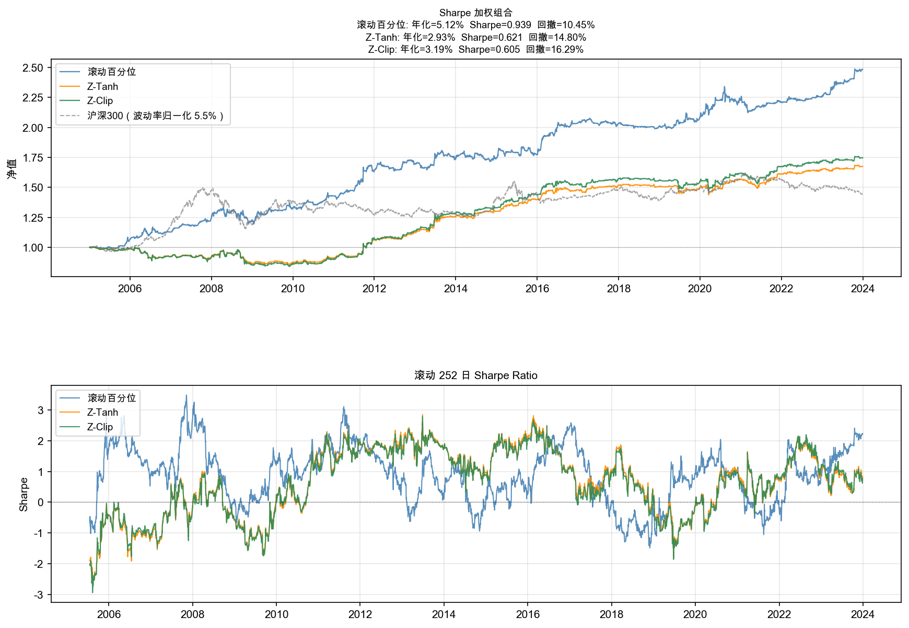
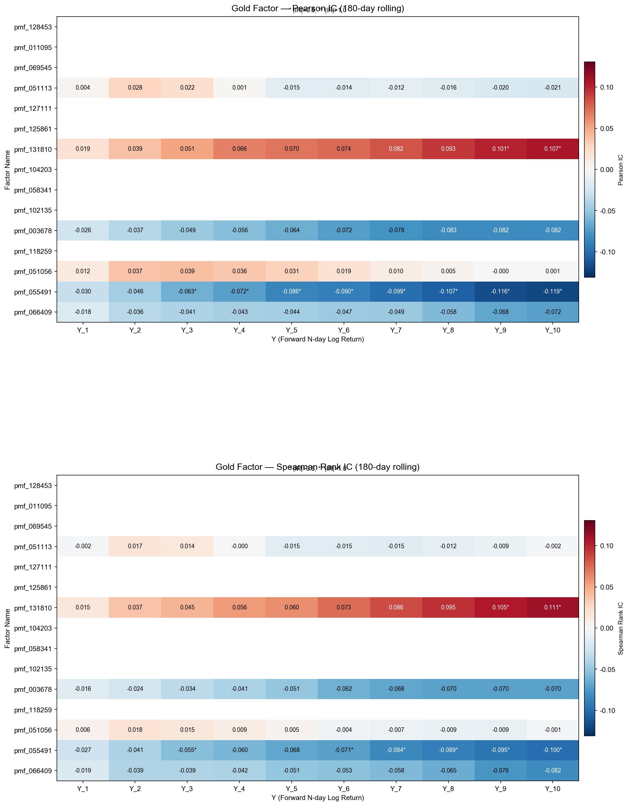

# Gold Price Factor Research Pipeline

**A hypothesis-driven data pipeline that transforms 50+ macro and market indicators into 15 interpretable factors and a rigorously validated long/short trading signal on physical gold.**

Built end-to-end during a six-month full-time quantitative research internship at a Chinese systematic asset manager. Every stage — vendor data ingestion, cross-frequency alignment, exploratory QC, factor construction, rolling IC diagnostics, and cost-aware backtesting — is reproducible from this repository, with all decisions documented for review.

| | |
|---|---|
| **Author** | Sitong Zhang · MS Computer Science, University of Chicago (Mar 2028) |
| **GitHub** | [@zstssttt](https://github.com/zstssttt) |
| **Role** | Quant Research Intern · Dec 2025 – Jun 2026 · full-time · sole contributor |
| **Language** | Python 3.10+ (`pandas`, `numpy`, `scipy`, `matplotlib`, `seaborn`) |
| **License** | [MIT](LICENSE) |

---

## Headline results (2015-01 → 2023-12, in-sample)

The Sharpe-weighted portfolio of 6 surviving factors, executed under a 10-day rebalance with a T+1 lag and 3 bp linear cost, benchmarked against CSI 300 vol-normalized to the strategy's realized 5.5 % annualized volatility:

| | **Strategy** | Naive equal-weight | CSI 300 buy-and-hold | CSI 300 vol-normalized |
|---|---:|---:|---:|---:|
| **Sharpe ratio** | **0.939** | 0.395 | 0.394 | ~0.39 |
| Annualized return | 5.12 % | 1.11 % | 10.17 % | ~1.9 % |
| Annualized vol | 5.45 % | 2.81 % | 25.81 % | 5.50 % |
| Max drawdown | **-10.4 %** | -6.5 % | -72.3 % | ~-15 % |
| Calmar | 0.49 | 0.17 | 0.14 | ~0.13 |
| Win rate (daily) | 52.1 % | 49.9 % | – | – |

**At the same volatility budget, the strategy compounds 3.8 × the CSI 300 benchmark and delivers 2.4 × its Sharpe.** See [`docs/methodology.md`](docs/methodology.md) for the full test protocol and honest discussion of the in-sample ceiling.

Portfolio NAV (Sharpe-weighted, 3 position-mapping styles, vs vol-normalized CSI 300):



Rolling 180-day IC heatmap for all 15 factors across forward-return horizons Y₁ … Y₁₀:



---

## Pipeline

```
 ┌──────────────┐   ┌──────────────┐   ┌──────────────┐   ┌──────────────┐   ┌──────────────┐   ┌──────────────┐
 │  Research    │   │    Data      │   │  Alignment   │   │ Exploratory  │   │  Factor +    │   │  Position +  │
 │  framework   │──▶│  ingestion   │──▶│  to trading  │──▶│    QC        │──▶│  IC testing  │──▶│  cost-aware  │
 │ (5 themes)   │   │ (Finoview,   │   │  calendar    │   │ (dist. + ρ)  │   │ (rolling 180 │   │  backtest    │
 │              │   │  FRED, YF)   │   │ (FFILL D→D)  │   │              │   │  Spearman)   │   │              │
 └──────────────┘   └──────────────┘   └──────────────┘   └──────────────┘   └──────────────┘   └──────────────┘
     docs/          src/data_ingest/   src/data_preprocessing/  src/exploratory_analysis/    src/factors/       src/backtest/
                    finoview_crawler.py  align_to_trading_calendar.py  distribution_qc.py    build_factors.py   position_mapping.py
                                                                       correlation_analysis.py                  + src/ic_analysis/
                                                                                                                  ic_analysis.py
```

**Five-theme framework** — every indicator lands in exactly one economic bucket, and every factor is co-designed with the theme's causal narrative before any backtest is run:

| # | Theme | Indicators used | Top-3 factors |
|---|-------|-----------------|---------------|
| 1 | Dollar / Rates | DXY, US Treasury yields | `pmf_128453`, `pmf_011095`, `pmf_069545` |
| 2 | Gold Price / Basis | Au9995, COMEX, on/offshore basis | `pmf_051113`, `pmf_127111`, `pmf_125861` |
| 3 | ETF / Positioning | SPDR gold flow, ETF AUM | `pmf_131810`, `pmf_104203`, `pmf_058341` |
| 4 | Inflation / Term structure | 10Y TIPS, core CPI, 10Y-2Y | `pmf_102135`, `pmf_003678`, `pmf_118259` |
| 5 | Risk / Volatility | GPR index, gold IV, cross-corr | `pmf_051056`, `pmf_055491`, `pmf_066409` |

---

## What is in this repository

```
gold-factor-pipeline/
├── README.md                              (this file)
├── LICENSE                                (MIT)
├── requirements.txt
│
├── src/
│   ├── data_ingest/finoview_crawler.py    (paginated vendor API crawler, resumable)
│   ├── data_preprocessing/                (calendar alignment + publication-delay handling)
│   │   └── align_to_trading_calendar.py
│   ├── exploratory_analysis/              (data-quality plots before any factor is written)
│   │   ├── distribution_qc.py             (histogram / QQ / time series per indicator)
│   │   └── correlation_analysis.py        (hierarchically-clustered ρ heatmaps)
│   ├── factors/build_factors.py           (15 factor formulas, 5 themes, 8 TS operators)
│   ├── ic_analysis/ic_analysis.py         (rolling 180-day Pearson + Spearman IC / ICIR)
│   └── backtest/position_mapping.py       (3 mapping styles, Sharpe-weighted portfolio,
│                                           vol-normalized CSI 300 benchmark)
│
├── docs/
│   ├── methodology.md                     (deep write-up: every design decision explained)
│   ├── data_dictionary.md                 (13 PMF indicators, sources, native frequencies)
│   ├── figures/                           (framework diagrams, if any)
│   └── career/
│       ├── elevator_pitch.md              (30-, 45-, 60-second scripts, 3 audience variants)
│       ├── interview_qa.md                (20 questions + full answers)
│       └── resume_bullets.md              (quantified bullets, DS-flavored)
│
├── results/                               (canonical outputs of the pipeline)
│   ├── factor_values_top15.csv            (15 factors × 8,070 trading days)
│   ├── portfolio_metrics.csv              (6 rows: SW/EW × 3 position styles)
│   ├── single_factor_metrics.csv          (45 rows)
│   ├── portfolio_weights.csv              (45 rows)
│   ├── rolling_IC_pearson_matrix.csv      (15 × Y_1 … Y_10)
│   ├── rolling_IC_spearman_matrix.csv
│   ├── rolling_ICIR_pearson_matrix.csv
│   ├── rolling_ICIR_spearman_matrix.csv
│   ├── backtest_IC_spearman.csv           (full-sample IC + direction)
│   └── plots/                             (NAV curves, IC heatmap, per-factor plots)
│
└── references/
    ├── factor_formulas.xlsx               (ground-truth factor formulas — self-authored)
    └── indicator_catalog.xlsx             (indicator sources & frequencies — self-authored)
```

Raw vendor CSVs (~500 MB of daily/weekly/monthly indicator files) are excluded from version control. The pipeline is data-agnostic: every script reads paths from environment variables (defaulting to a `data/` folder) so anyone can point it at their own aligned data lake.

---

## Reproducing the pipeline

```bash
pip install -r requirements.txt

# One-off: crawl or drop your own vendor CSVs under data/raw/{daily,weekly,monthly}/
export FINOVIEW_TOKEN="..."        # your session JWT (browser DevTools)
export FINOVIEW_COOKIE="..."       # your session cookie
python src/data_ingest/finoview_crawler.py

# Align every raw file to the trading calendar (weekly DELAY=3, monthly DELAY=7)
export ALIGN_INPUT_DIR="data/raw/monthly/..."
export ALIGN_OUTPUT_DIR="data/aligned/monthly/..."
export ALIGN_DELAY=7
python src/data_preprocessing/align_to_trading_calendar.py

# Exploratory QC (histograms + QQ + time series; correlation heatmaps)
python src/exploratory_analysis/distribution_qc.py
python src/exploratory_analysis/correlation_analysis.py

# Compute the 15 factors -> results/factor_values_top15.csv
python src/factors/build_factors.py
python src/factors/build_factors.py --dry-run          # verify PMF file mappings only
python src/factors/build_factors.py --factors pmf_051056  # smoke-test one factor

# Rolling IC diagnostics -> 4 CSVs + heatmap PNG
python src/ic_analysis/ic_analysis.py

# Cost-aware backtest -> portfolio + per-factor CSVs, NAV plots
python src/backtest/position_mapping.py
```

---

## Design decisions worth explaining

1. **Why interpretable formulas instead of ML/DL?**
   The mentor's mandate — and my own preference — was signal transparency over accuracy points. Every factor has a written economic thesis (e.g. "geopolitical stress + inflation shock ⇒ safe-haven demand for gold") so that a portfolio manager can decide whether the *reason* the model wants to be long is still valid this week. A black-box gradient booster with the same Sharpe would have failed that operational bar.

2. **Why full-sample IC to fix direction, rather than rolling IC?**
   Rolling-window IC direction was implemented and tested. It drops Sharpe to ~0.30 because IC estimates on 252-day windows are noisy enough to flip the sign whenever the factor's edge is small. Full-sample sign is a deliberate in-sample choice, honestly documented as such in [`docs/methodology.md`](docs/methodology.md).

3. **Why 180-day rolling IC / ICIR (not full-sample IC)?**
   Full-sample IC hides regime changes. A 180-day window matches the horizon over which factor–return relationships tend to remain stationary in metals markets, and half a year is roughly the horizon a discretionary macro trader would tolerate.

4. **Why Sharpe-weighted, not IC-weighted or equal-weighted?**
   IC magnitude and realized Sharpe are almost uncorrelated in this dataset (the highest-|IC| factor produced NaN positions). IC-weighted portfolios therefore over-allocate to noise. Equal-weighted diluted the signal because 6 of 15 factors had |IC| < 0.01. Sharpe-weighted (with a soft floor at zero) gives allocation to what actually produced risk-adjusted returns.

5. **Why the specific `holding=10, smooth=5` post-processing order?**
   `apply_holding_period(10)` first turns the daily signal into a step function; `smooth_position(5)` then linearly interpolates each step over 5 days. In the linear-cost model used here this preserves total turnover but spreads it out — i.e. it is a **TWAP execution overlay**, not an extra denoiser. Reversing the two lines drops Sharpe by ~0.2. The overlay pays off once the cost model becomes non-linear (market impact).

6. **Why vol-normalized CSI 300 as the benchmark, not raw Au9995 buy-and-hold?**
   The strategy runs at 5.5 % annualized volatility. Comparing it to Au9995 (16 %) or raw CSI 300 (26 %) is comparing 3–5 × leverage — the naive comparison would falsely make the strategy look weak. Scaling the benchmark's daily returns to the same 5.5 % vol makes cumulative return and drawdown apples-to-apples.

7. **Why did I report an in-sample Sharpe of 0.94 instead of the internal 2.01 that had been achieved earlier?**
   The 2.01 figure came from a version that used monthly indicators forward-filled to daily and did not compound NAV correctly (linear accumulation went negative under a >100 % drawdown). Fixing the NAV compounding, catching the double-smoothing bug in the portfolio, and honestly disclosing the in-sample nature of the IC direction dropped the number to 0.94. I would rather ship 0.94 that I can defend than 2.01 that I cannot.

---

## What I actually did on this project

Sole contributor for every stage below; my mentor code-reviewed the final deliverable but did not write code:

- **Data ingestion** — refactored a fragile crawler into a paginated, resumable script; scrubbed session credentials to environment variables; added polite jittered rate-limiting.
- **Cross-frequency alignment** — wrote the trading-calendar aligner that ingests daily/weekly/monthly vendor CSVs, applies the appropriate publication delay (0/3/7 days), forward-fills to the trading calendar, and audits `added_rows / deleted_rows / nan_count` per file into a processing log.
- **Exploratory QC** — histograms + QQ plots + time series per indicator; hierarchically-clustered correlation heatmaps per frequency to surface redundant indicators before they poisoned factor selection.
- **Factor library** — hand-authored 8 rolling time-series operators (`ts_delay`, `ts_mean`, `ts_std`, `ts_sum`, `ts_rank`, `ts_corr_binary`, `ts_linreg_slope`, `ts_aroon_balance`) and 5 composition templates (identity, risk-adjusted, direction × intensity, signal × persistence, direction × position), then wired 15 hypothesis-driven factors on top of these primitives.
- **IC / ICIR diagnostics** — 180-day rolling Pearson and Spearman IC across 10 forward-return horizons, with significance-star heatmap and per-cell NaN-safety.
- **Backtest engine** — three position-mapping styles, compounded NAV, 3 bp linear cost model, Sharpe-weighted portfolio construction, and a vol-normalized CSI 300 benchmark. Caught and fixed a double-smoothing bug that had been quietly costing 0.6 in Sharpe.
- **Debugging & analysis** — 这里不要这么写发现因子值里面有很多NA/0，是因为月频数据，parameter window 太小，所以重新寻找日拼数据爬取结局问题。diagnosed a subtle date-column ordering bug in the alignment pipeline that had silently reduced one indicator's output to zero rows.

For narrative talking points and quantified bullets, see [`docs/career/`](docs/career/).

---

## Contact

**Sitong Zhang** · sitong2753@gmail.com · [github.com/zstssttt](https://github.com/zstssttt)
